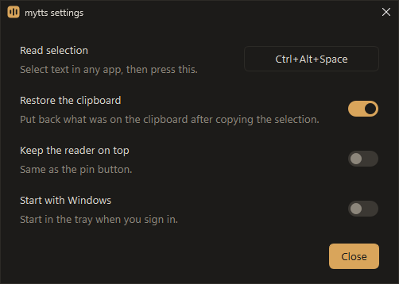

# mytts

An offline, minimalist read-aloud app for Windows. Select text in any window, press a hotkey, and a small reader window opens and starts speaking with a natural voice. The sentence being read is highlighted, and clicking any sentence jumps there.


- **Natural voices, fully offline.** 41 neural voices run on your computer. Nothing you read is sent anywhere.
- **Works from any app.** Press **Ctrl+Alt+Space** in a browser, PDF reader, editor or terminal, and the selection is read.
- **Follow along.** The current sentence is highlighted; click a sentence to jump to it, or use Left and Right.
- **Easy on the eyes.** Dark and sepia themes, a comfortable line length, and a window that can stay on top.

## Install

You need Windows 10 or 11 and 64-bit [Python](https://www.python.org/downloads/windows/) 3.10 to 3.13. If you don't have it, `winget install Python.Python.3.12` installs it.

Get the source, then run the installer from that folder:

```powershell
git clone https://github.com/rahuljeyaraj/mytts.git
cd mytts
powershell -ExecutionPolicy Bypass -File install.ps1
```

It doesn't need administrator rights, and takes a few minutes, mostly for downloading about 480 MB. It:

1. creates a Python environment of its own in `%LOCALAPPDATA%\mytts\venv` and installs mytts there,
2. downloads the voice model (354 MB, once; checked against a fixed SHA-256),
3. adds **mytts** to the Start menu and to **Settings > Apps**, and starts it.

| Option | |
| --- | --- |
| `-Startup` | Also start mytts in the notification area when you sign in. |
| `-NoModel` | Don't download the voice model now; the reader window offers it on first start. |
| `-NoLaunch` | Don't start mytts at the end. |
| `-Python C:\path\to\python.exe` | Use this Python. By default the newest suitable one registered in Windows is used. |

**Update:** get the new source (`git pull`) and run `install.ps1` again. It closes the running copy, updates it and keeps the voice model and your settings.

**Uninstall:** remove **mytts** in **Settings > Apps**, or run `powershell -ExecutionPolicy Bypass -File uninstall.ps1`. That removes the program, the shortcut, the startup entry and the voice model. Your settings stay in `%APPDATA%\mytts` unless you add `-RemoveSettings`; add `-KeepModel` to keep the voice model for a later install.

## Read from any app

Start mytts, select text in any app and press **Ctrl+Alt+Space**. The reader window comes to the front and starts reading.

These hotkeys work from any app, even when the reader window is behind other windows:

| Hotkey | Action |
| --- | --- |
| Ctrl+Alt+Space | Read the selection. While reading, it pauses; press it again to resume. If you have selected different text in the meantime, that text is read instead. |
| Ctrl+Alt+Right | Next sentence |
| Ctrl+Alt+Left | Previous sentence |

mytts copies the selection by sending the app Ctrl+C, then puts back whatever was on the clipboard before (text, images and files alike). In terminals (Windows Terminal, the classic console, Git Bash, PuTTY, ConEmu) it sends Ctrl+Insert instead, because Ctrl+C there would stop the running program. If nothing is selected, the window just comes to the front.

Windows does not let a normal app send keys to an app running as administrator, so selections in elevated windows can't be read.

## The reader window

Closing the window pauses reading and hides it in the notification area. Click the tray icon to bring it back, middle-click it to play or pause, or right-click it for Read selection, Pause/Resume, Stop, Settings and Quit. Only one copy runs at a time: starting mytts again brings the window to the front.

Paste text with **Ctrl+V** and it is read from the start.

| Key | Action |
| --- | --- |
| Space | Play / pause |
| Esc | Stop |
| Left / Right | Previous / next sentence |
| Ctrl+V | Paste and read |
| Ctrl+C | Copy the selected text |
| Ctrl+= / Ctrl+- / Ctrl+0, Ctrl+wheel | Text size |

The bottom bar has the voice list, a speed slider (0.5× to 2×; double-click the value to reset), the dark/sepia theme switch, a pin button that keeps the window on top, and the settings button.

<p>
  
  
</p>

## Settings

- **Hotkeys** for Read selection, Next sentence and Previous sentence: click one and press a new combination (it needs Ctrl, Alt or Win). If another app or another mytts action already uses it, the settings window says so.
- **Restore the clipboard:** turn it off to keep the copied selection on the clipboard.
- **Keep the reader on top:** the same as the pin button.
- **Start with Windows:** starts mytts in the tray when you sign in.

The voice, speed, theme, text size and window position are remembered too. Settings are saved in `%APPDATA%\mytts\settings.json`.

## Voices

mytts uses [Kokoro-82M](https://huggingface.co/hexgrad/Kokoro-82M), an open neural text-to-speech model, running locally through ONNX Runtime. It reads about four times faster than real time on an ordinary laptop CPU, so speech starts about half a second after you press the hotkey.

There are 41 voices in English (US and UK), Spanish, French, Hindi, Italian and Brazilian Portuguese. The default is **Heart**, the highest-rated Kokoro voice. The model lives in `%LOCALAPPDATA%\mytts\models` (set the `MYTTS_MODELS_DIR` environment variable to keep it elsewhere).

## Command line

The installed copy has a command line too:

```powershell
$mytts = "$env:LOCALAPPDATA\mytts\venv\Scripts\mytts.exe"
& $mytts open "Text to read now."          # open the reader and read this
Get-Clipboard | & $mytts open -            # read stdin in the reader
& $mytts say "Hello there." -v bf_emma     # speak without a window
& $mytts say "Hello." -o hello.wav         # save as WAV
& $mytts voices                            # list the voice ids
& $mytts quit                              # close the running app
```

`--tray` starts mytts hidden in the notification area. `say` takes `-s` for the speed (0.5 to 2.0).

## Development

```powershell
py -3.10 -m venv .venv
.venv\Scripts\python -m pip install -r requirements.txt pytest
.venv\Scripts\python -m mytts                 # run from the source folder
.venv\Scripts\python -m pytest -q             # tests (no audio device or model needed)
.venv\Scripts\python tools\screenshots.py     # regenerate the screenshots in docs\
```

[ROADMAP.md](ROADMAP.md) describes how the app is built, milestone by milestone, with measurements and known limits.

## Credits

- Kokoro-82M by hexgrad, Apache-2.0.
- [kokoro-onnx](https://github.com/thewh1teagle/kokoro-onnx) by thewh1teagle, MIT; the ONNX model files are downloaded from its releases.
- Pronunciation by [eSpeak NG](https://github.com/espeak-ng/espeak-ng) through `espeakng-loader` and `phonemizer`, GPL-3.0.

## License

MIT
