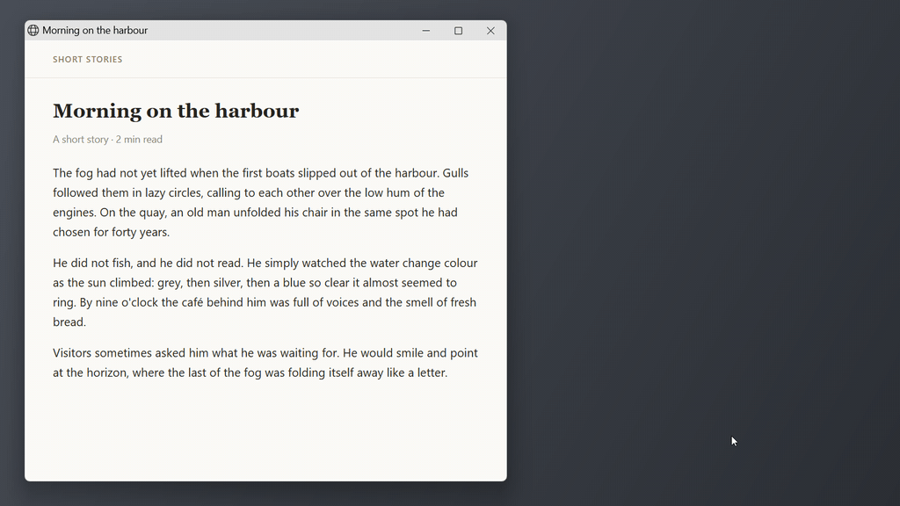
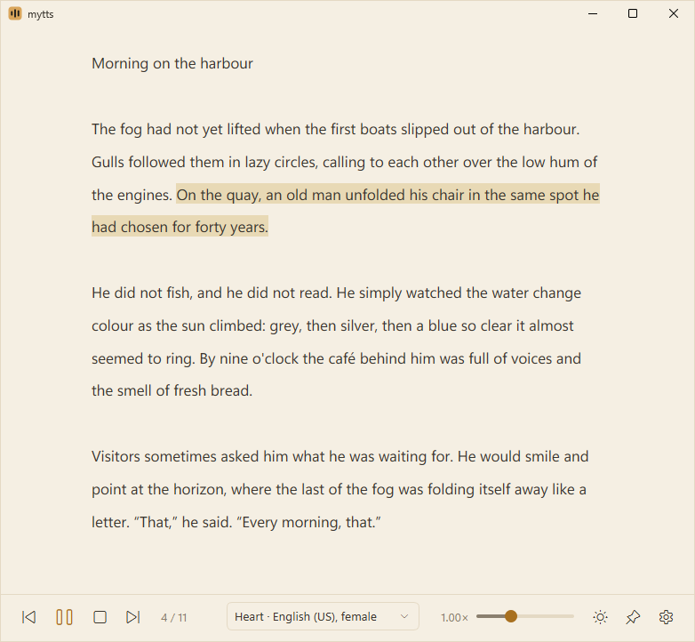

<div align="center">


# myTTS

**Select text in any app, press a hotkey, and listen. Natural voices that run entirely on your PC.**

[](https://github.com/rahuljeyaraj/myTTS/releases/latest)
[](https://github.com/rahuljeyaraj/myTTS/releases)
[](https://github.com/rahuljeyaraj/myTTS/actions/workflows/ci.yml)
[](#license)
[](#system-requirements)



### [⬇ Download myTTS for Windows](https://github.com/rahuljeyaraj/myTTS/releases/latest)

Free and open source · No account · Nothing leaves your computer

</div>

## Features

- **Natural voices, fully offline.** 41 neural voices run on your own computer. After the one-time voice download, myTTS never goes online: what you read stays with you.
- **Works in any app.** Select text in a browser, a PDF, an email, an editor or a terminal, press **Ctrl+Alt+Space**, and it is read aloud.
- **Follow along.** The sentence being read is highlighted. Click any sentence to jump there, or skip with the arrow keys or with hotkeys from any app.
- **Pause from anywhere.** Press the same hotkey to pause and again to resume, without switching windows.
- **Easy on the eyes.** A quiet reader window with dark and sepia themes, a comfortable line length and adjustable text size. Pin it on top if you like.
- **Stays out of the way.** myTTS waits in the notification area, starts with Windows if you want, and puts your clipboard back the way it was.

<p align="center">
  
  
</p>

## Install

1. Download `myTTS-setup-<version>.exe` from the [latest release](https://github.com/rahuljeyaraj/myTTS/releases/latest).
2. Run it. It needs no administrator rights and no Python.
3. Setup downloads the voice model (354 MB, once) and adds myTTS to the Start menu. Tick **Start myTTS when I sign in to Windows** if you want it ready at all times.

Windows may say **"Windows protected your PC"**, because the installer isn't code-signed yet. Click **More info**, then **Run anyway**. See [the FAQ](#windows-says-windows-protected-your-pc-is-it-safe) for how to check your download.

**Update:** run the newer setup. It closes myTTS, replaces it and keeps your voices and settings.

**Uninstall:** remove **myTTS** in **Settings > Apps**. You are asked whether to remove the voice model too.

## How to use it

Start myTTS from the Start menu. Then, in any app, select some text and press **Ctrl+Alt+Space**. The reader window comes up and starts reading.

### Hotkeys (from any app)

| Hotkey | What it does |
| --- | --- |
| **Ctrl+Alt+Space** | Read the selection. While reading, it pauses; press it again to resume. If you selected something new in the meantime, that is read instead. |
| **Ctrl+Alt+Right** | Next sentence |
| **Ctrl+Alt+Left** | Previous sentence |

You can change all three in Settings.

### In the reader window

| Key | What it does |
| --- | --- |
| Click a sentence | Read from there |
| Space | Play or pause |
| Esc | Stop |
| Left, Right | Previous or next sentence |
| Ctrl+V | Paste text and read it from the start |
| Ctrl+C | Copy the selected text |
| Ctrl+=, Ctrl+-, Ctrl+0, Ctrl+mouse wheel | Text size |

The bar at the bottom has the voice list, the speed (0.5× to 2×; double-click the number to reset it), the theme switch, the pin that keeps the window on top, and Settings.

Closing the window pauses reading and keeps myTTS in the notification area. Click the tray icon to bring the window back, middle-click it to play or pause, or right-click it for more.

### Settings


- **Hotkeys:** click one and press a new combination. It needs Ctrl, Alt or Win. If another app already uses it, Settings tells you.
- **Restore the clipboard:** myTTS copies the selection to read it, then puts back what was on the clipboard before. Turn this off to keep the copied text.
- **Keep the reader on top:** the same as the pin button.
- **Start with Windows:** start in the notification area when you sign in.

The voice, speed, theme, text size and window position are remembered too.

<br clear="right">

## FAQ

### Windows says "Windows protected your PC". Is it safe?

myTTS isn't code-signed yet: a certificate costs money every year, and an application for free signing for open source projects is planned. Until then, SmartScreen warns about any new unsigned program. Click **More info**, then **Run anyway**.

To make sure your download is the file the release published, compare its SHA-256 with the one listed in the release notes and in `SHA256SUMS.txt`:

```powershell
Get-FileHash .\myTTS-setup-1.0.1.exe
```

Every release is built from the tagged source code by [GitHub Actions](.github/workflows/release.yml), and you can [build it yourself](#development).

### Does anything I read leave my computer?

No. The voices run on your computer with [ONNX Runtime](https://onnxruntime.ai/). The only network use is downloading the voice model, once, from the [kokoro-onnx releases](https://github.com/thewh1teagle/kokoro-onnx/releases) on GitHub. myTTS has no telemetry, no account and no update check. Its log file records how long each selection was, never the text.

### Can it read without an internet connection?

Yes, once the voice model is downloaded. You can unplug the network and myTTS works the same.

### Which languages and voices are there?

41 voices: English (American and British), Spanish, French, Hindi, Italian and Brazilian Portuguese. The default is **Heart**, an American English voice and the best rated one. Pick a voice in the list at the bottom of the reader window; it is remembered. Each voice reads its own language best.

### Why can't it read the selection in some windows?

Windows doesn't let a normal app send keys to an app that runs as administrator, so a selection in an elevated window can't be copied. In terminals, myTTS copies with Ctrl+Insert instead of Ctrl+C, so it never stops a running program. If nothing is selected, the reader window just comes to the front: paste text into it with Ctrl+V.

### System requirements

- Windows 10 or 11, 64-bit (x64).
- About 520 MB of disk space: 160 MB for the app and 354 MB for the voices.
- Memory: myTTS uses about 0.8 to 1.5 GB while it runs, because the voice model stays loaded so speech starts at once.
- Any recent CPU. On an ordinary laptop, speech is generated about four times faster than it is spoken, and starts about half a second to a second after the hotkey.
- No graphics card, Python or internet connection needed (except for the voice download).

### Where are my files?

| What | Where |
| --- | --- |
| The program | `%LOCALAPPDATA%\Programs\mytts` |
| The voice model | `%LOCALAPPDATA%\mytts\models` (set `MYTTS_MODELS_DIR` to keep it elsewhere) |
| Settings | `%APPDATA%\mytts\settings.json` |
| Log files | `%LOCALAPPDATA%\mytts\logs` (Settings > About > Log files opens the folder) |

### How do I uninstall it completely?

Remove **myTTS** in **Settings > Apps** and choose **Remove the voice model**. That removes the program, the shortcuts, the startup entry, the logs and the voices. Your settings file stays in `%APPDATA%\mytts`; delete that folder too if you want nothing left.

### Is there a command line?

Yes. `myTTS.exe` in the program folder takes commands:

```powershell
$mytts = "$env:LOCALAPPDATA\Programs\mytts\myTTS.exe"
& $mytts open "Text to read now."          # open the reader and read this
& $mytts say "Hello there." -v bf_emma     # speak without a window
& $mytts say "Hello." -o hello.wav         # save as a WAV file
& $mytts voices                            # list the voice ids
& $mytts quit                              # close the running app
```

`--tray` starts myTTS in the notification area, and `say` takes `-s` for the speed (0.5 to 2.0). `--help` lists everything.

## Background

myTTS was inspired by [FluentVoice Pro](https://github.com/nickotmazgin/fluentvoice-pro) by Nick Otmazgin, a polished and generous free read-aloud app for Windows. It showed how pleasant "select, press a key, listen" can be. The goal for the voices came from Google's natural voices in the [Read Aloud](https://chromewebstore.google.com/detail/read-aloud-a-text-to-spee/hdhinadidafjejdhmfkjgnolgimiaplp) Chrome extension: speech you can listen to for an hour. myTTS tries to get that quality with no cloud at all, using the open [Kokoro](https://huggingface.co/hexgrad/Kokoro-82M) model. Thank you to both projects.

### What myTTS does differently

Both apps are free. They make different trade-offs, and FluentVoice Pro may suit you better if you want many languages or online voices. This compares myTTS with FluentVoice Pro **1.6.7** as its README describes it (November 2026):

| | myTTS | FluentVoice Pro 1.6.7 |
| --- | --- | --- |
| Following along | The sentence being read is highlighted in the reader window; click any sentence to jump there | A status line shows the part and time being spoken ("part 2/7 • 1:05 / 3:10") |
| Voices | 41 Kokoro voices in 7 languages | 80 Microsoft online voices in 22 languages, Windows voices, and offline Piper and Kokoro voices |
| Network | Fully offline after the one-time voice download; no online voices | Online voices need the internet; an "Offline only" switch keeps text on the computer |
| Hotkey | Reads, pauses and resumes; separate hotkeys for the next and previous sentence | Speaks or stops; a second, optional hotkey only stops. It can also read everything you copy |
| Install | An installer, per user | Microsoft Store, winget, Scoop, a portable EXE, or from source |
| Windows on ARM | Not yet | Yes |

## Development

```powershell
git clone https://github.com/rahuljeyaraj/myTTS.git
cd myTTS
py -3.13 -m venv .venv
.venv\Scripts\python -m pip install -r packaging\requirements-lock.txt
.venv\Scripts\python -m mytts download        # the voice model, once
.venv\Scripts\python -m mytts                 # run from the source folder
.venv\Scripts\python -m pytest -q             # tests (no audio device or model needed)
```

**Build** the self-contained `myTTS.exe` and, with `-Installer`, `dist\myTTS-setup-<version>.exe` (needs [Inno Setup 6](https://jrsoftware.org/isinfo.php): `winget install JRSoftware.InnoSetup`):

```powershell
powershell -ExecutionPolicy Bypass -File packaging\build.ps1 -SelfTest -Installer
```

`-SelfTest` loads the voice model in the built exe and synthesizes one sentence.

**Install from source** (for developers): `install.ps1` installs a checkout into a Python environment of its own (`%LOCALAPPDATA%\mytts\venv`) with a Start menu shortcut. It needs 64-bit Python 3.11 to 3.13. Options: `-Startup`, `-NoModel`, `-NoLaunch`, `-Python <path>`. It refuses to run while the setup version is installed, and setup replaces a copy installed this way. `uninstall.ps1` removes it (`-KeepModel`, `-RemoveSettings`).

**Images:** `tools\screenshots.py` regenerates the screenshots, `tools\demo.py` records the demo GIF and an MP4 with sound (it takes over the screen for a minute), and `tools\social_preview.py` draws the icon and the social preview image.

**Releases:** [CI](.github/workflows/ci.yml) runs the tests on every push and pull request. Pushing a tag `v<version>` runs the [release workflow](.github/workflows/release.yml): it builds with the exact versions in `packaging\requirements-lock.txt`, tests and self-tests the build, and creates a **draft** release with the installer, `SHA256SUMS.txt` and the GPL source of eSpeak NG and phonemizer. A draft is published by hand after review.

See [CONTRIBUTING.md](CONTRIBUTING.md) to contribute, and [ROADMAP.md](ROADMAP.md) for how the app was built, with measurements and known limits.

## Credits

- [Kokoro-82M](https://huggingface.co/hexgrad/Kokoro-82M) by hexgrad, the voice model (Apache-2.0).
- [kokoro-onnx](https://github.com/thewh1teagle/kokoro-onnx) by thewh1teagle, which runs it with ONNX Runtime (MIT); the model files are downloaded from its releases.
- [eSpeak NG](https://github.com/espeak-ng/espeak-ng) and [phonemizer](https://github.com/bootphon/phonemizer), which turn text into phonemes (GPL-3.0).
- [Qt for Python](https://www.qt.io/qt-for-python) (PySide6) for the interface (LGPL-3.0), and [PortAudio](https://www.portaudio.com/) through [sounddevice](https://github.com/spatialaudio/python-sounddevice) for audio.

## License

The myTTS source code is under the [MIT License](LICENSE).

The installer and `myTTS.exe` also contain eSpeak NG and phonemizer, which are GPL-3.0-or-later, so the program as distributed is under the terms of the GNU GPL version 3. Each release carries the source code of the eSpeak NG and phonemizer versions it bundles. [THIRD_PARTY_NOTICES.md](THIRD_PARTY_NOTICES.md) lists every bundled component and its license, and the installed app has the license texts in its `licenses` folder.
